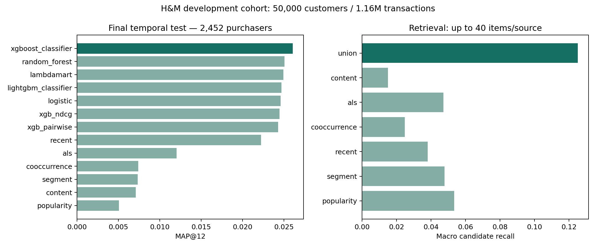

# Personalized Recommendation & Learning-to-Rank

A two-stage H&M fashion recommender: retrieve relevant articles, then learn a personalized top-12 ordering. The project compares six retrieval baselines and seven ML scorers using weekly temporal holdouts, candidate recall, cold-start/segment analysis, and candidate/feature ablations.

**Completed development experiment:** 50,000 customers, 1,156,381 actual transactions, 105,542 article metadata records. The raw CSV contains 31,788,324 transactions; model experiments use the fixed customer sample. These are offline development results, not full-dataset Kaggle scores or online business lift.

## Results

The validation-selected **XGBoost classifier scorer** achieved test **MAP@12 = 0.02607**, versus **0.02224** for a recent-purchase recommender (**+17.3% relative**) and **0.00505** for decayed popularity. The final test week contains 2,452 purchasing customers. Every method uses the same users and target sets, including cold-start customers.

| Model | MAP@12 | Recall@12 | NDCG@12 |
|---|---:|---:|---:|
| Decayed popularity | 0.00505 | 0.02132 | 0.01105 |
| Age-segment popularity | 0.00732 | 0.02203 | 0.01305 |
| Recent purchases + popularity fallback | 0.02224 | 0.04544 | 0.03239 |
| Implicit ALS + popularity fallback | 0.01203 | 0.02832 | 0.01917 |
| Logistic scorer | 0.02462 | 0.05252 | 0.03615 |
| Random forest scorer | 0.02507 | 0.05287 | 0.03707 |
| LightGBM classifier scorer | 0.02469 | 0.05381 | 0.03710 |
| **XGBoost classifier scorer** | **0.02607** | **0.05530** | **0.03862** |
| XGBoost pairwise ranker | 0.02432 | 0.05223 | 0.03623 |
| XGBoost NDCG LambdaMART | 0.02447 | 0.05288 | 0.03641 |
| LightGBM LambdaMART | 0.02495 | 0.05159 | 0.03676 |



The hybrid union reaches **12.50% macro candidate recall**, versus 5.34% for 40 popularity candidates, at about 147 candidates per customer. Retrieval remains the main limitation. Removing recency features reduces the selected scorer's MAP@12 to 0.02418; removing ALS features slightly improves it to 0.02641. An algorithm being more complex does not guarantee a better result.

Full comparisons, tuning, segments, diversity, ablations and the exact run configuration are in [the experiment report](reports/hm_sample/report.md). Two expanding temporal validation folds are in [rolling_validation.csv](reports/hm_sample/rolling_validation.csv). Bootstrap intervals and the sample/measurement limits accompany the report.

## Pipeline

```text
H&M transactions / customers / articles
  → weekly cutoffs with past-only behavioral features
  → popularity + age segment + recency + co-occurrence + implicit ALS + content retrieval
  → candidate union, source flags, candidate recall
  → user / article / affinity / interaction / retrieval features
  → candidate hard-negative sampling for training only
  → pointwise and grouped learning-to-rank models
  → distinct top-12 recommendations
  → temporal test, segments, cold start, diversity, ablations
```

Two training snapshots predict Aug 26–Sep 1 and Sep 2–8, 2020. Validation predicts Sep 9–15; final test predicts Sep 16–22. Each snapshot uses a 120-day lookback. A query is one customer-week. Settings are chosen on validation, then rankers are refitted with train plus validation rows before final test scoring. Actual target items absent from retrieval still count against recall and ranking metrics.

## Run locally

Run commands from this `ranking/` folder. Python 3.11+ is required. Only the three competition CSVs are needed; product images are not used.

```bash
python3 -m venv .venv
.venv/bin/python -m pip install -r requirements.txt
# Place the three official CSVs in data/raw/, then:
make prepare
make eda
make run
make rolling
make publish
```

The existing local `.venv` is already installed and the commands above have been run against the downloaded data. `make run` took about 2.4 minutes on the local machine for this sample, excluding preparation and the additional rolling-fold analysis. Outputs with customer IDs, feature matrices and saved models stay ignored locally. `make publish` copies only selected aggregate reports/figures into the Git-visible `reports/hm_sample/` directory.

`configs/hm_sample.json` controls this experiment. A larger customer cohort requires rerunning preparation and rebuilding all weekly features/retrievers; do not label these 50,000-user scores as full-dataset results. Final test data should not become an iterative tuning target.

## Repository guide

- `src/ranking/data.py`: H&M ingestion, stable customer sample, temporal windows.
- `candidates.py`: six retrieval sources, sparse implicit ALS, TF-IDF/SVD content model.
- `features.py`: historical features, customer-week labels, hard-negative sampling.
- `models.py`: seven pointwise / learning-to-rank scorers.
- `pipeline.py`: training, validation selection, held-out test and diagnostics.
- `analysis.py`, `rolling.py`, `reporting.py`: EDA, segments, temporal folds, aggregate reports.
- `notebooks/`: walkthroughs for data, baselines and model interpretation.
- `docs/`: original proposal, experiment design, execution checklist, GitHub steps, A/B proposal and three résumé bullets.

Start with [the Chinese execution guide](docs/roadmap_zh.md) and [the incremental GitHub guide](docs/github_steps_zh.md).

## Interpretation

H&M records purchases, without logged impressions or inventory. A nonpurchase is not a verified dislike; classifier outputs after negative sampling are ranking scores, not calibrated conversion probabilities. Article eligibility is defined by purchases before the cutoff, and age/product attributes come from a static metadata snapshot. Cold-item analysis reports unseen future articles as unretrievable rather than assuming they were available. Coverage is measured against the 23,120-item eligible test catalog.

XGBRanker is an API supporting ranking objectives. `rank:ndcg` and LightGBM `lambdarank` are LambdaMART-style methods with metric-weighted pairwise gradients; this project does not call them distinct listwise/neural architectures. The optional two-tower extension has not been implemented. [The online A/B test](docs/online_ab_test.md) is a proposed next step, not a conducted experiment.

## Sources

- [Official H&M competition data](https://www.kaggle.com/competitions/h-and-m-personalized-fashion-recommendations/data)
- [XGBoost learning-to-rank documentation](https://xgboost.readthedocs.io/en/stable/tutorials/learning_to_rank.html)
- [LightGBM ranker documentation](https://lightgbm.readthedocs.io/en/stable/pythonapi/lightgbm.LGBMRanker.html)
- [Hu, Koren & Volinsky: Collaborative Filtering for Implicit Feedback Datasets](https://doi.org/10.1109/ICDM.2008.22)

Raw competition data is not redistributed. Follow the original competition terms when obtaining or using it.
