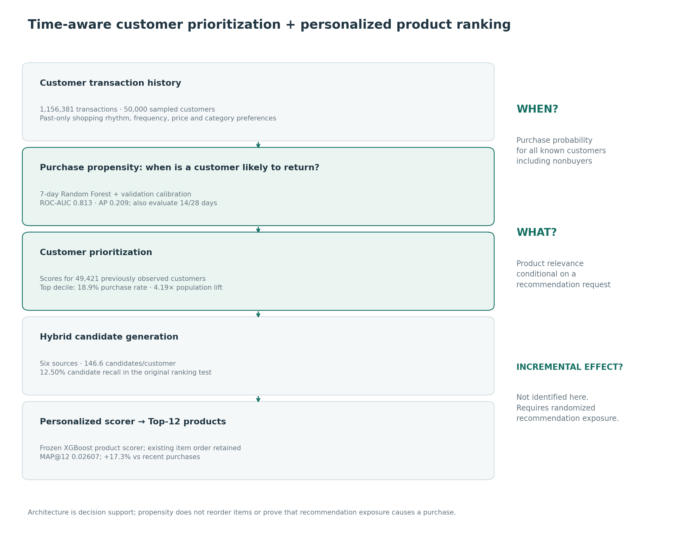
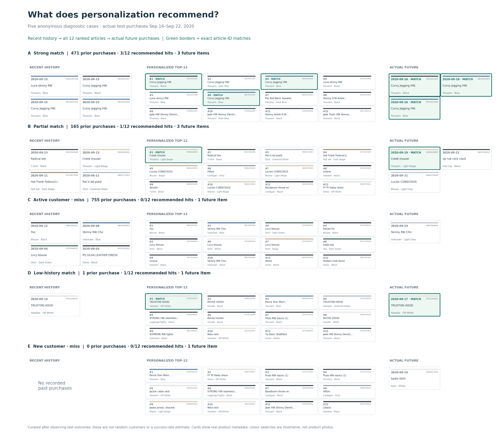
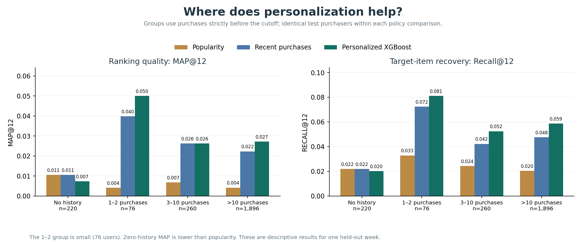
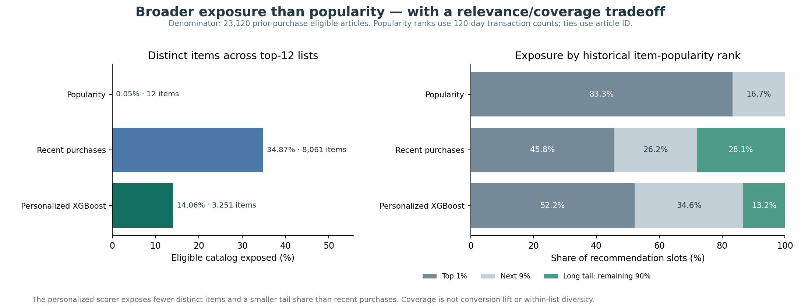
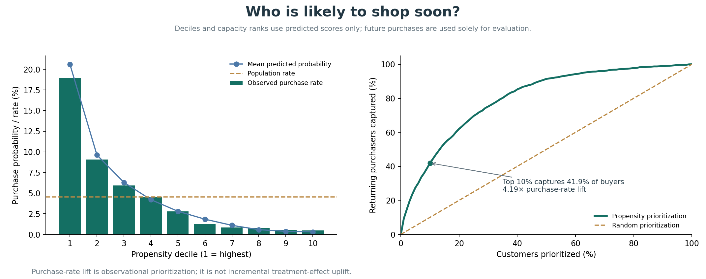
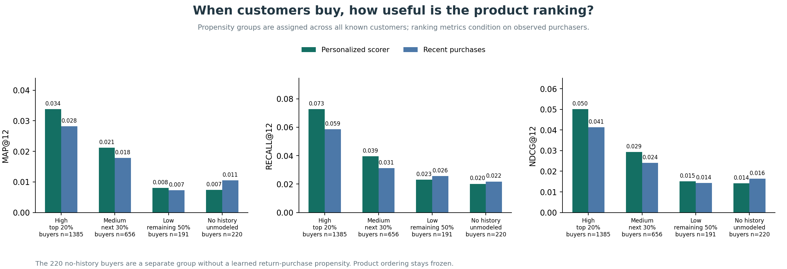
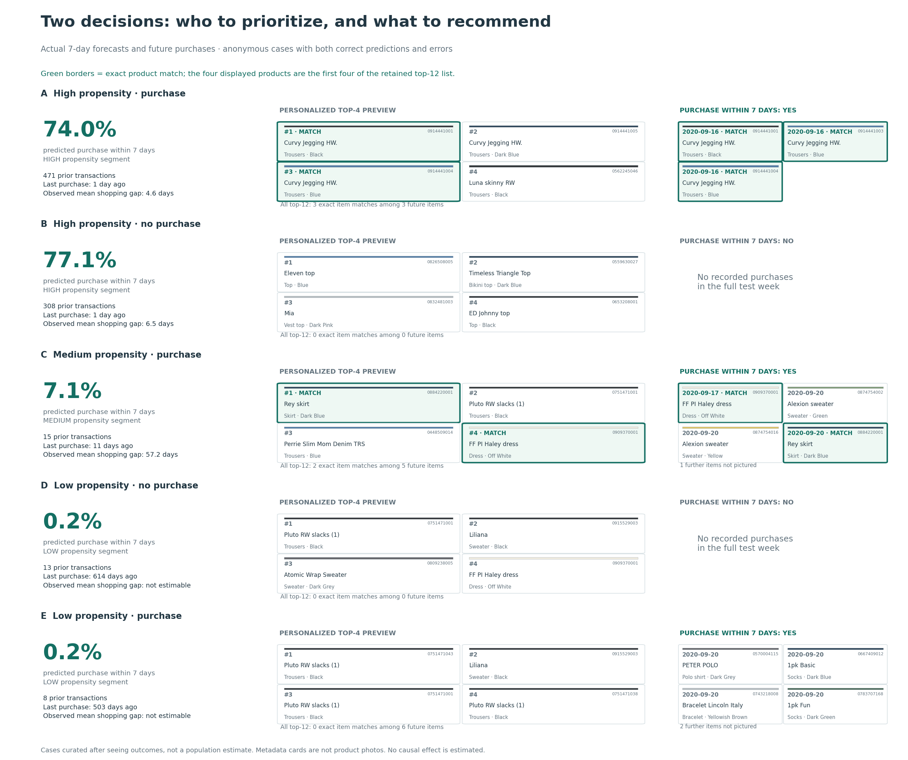
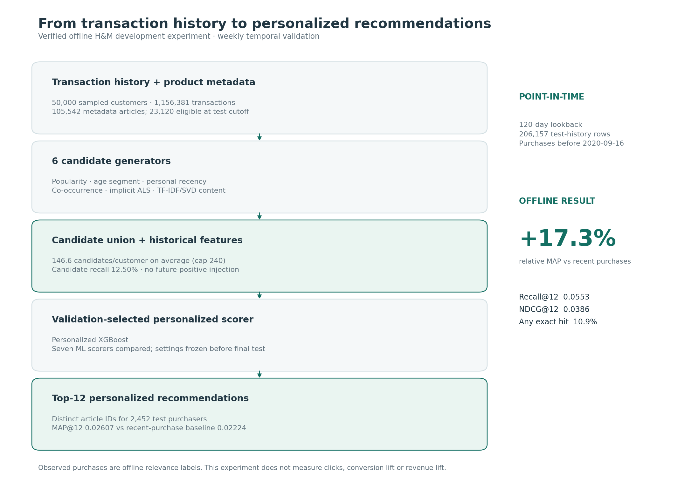

# Personalized Recommendation & Learning-to-Rank

A time-aware H&M recommendation system supporting two decisions: **when a customer is likely to return, and which products to recommend**. A longitudinal purchase-propensity layer connects customer prioritization to the existing two-stage recommender. The recommender compares six retrieval baselines and seven ML scorers using weekly temporal holdouts, candidate recall, cold-start/segment analysis, and candidate/feature ablations.

**Completed development experiment:** 50,000 customers, 1,156,381 actual transactions, 105,542 article metadata records. The raw CSV contains 31,788,324 transactions; model experiments use the fixed customer sample. These are offline development results, not full-dataset Kaggle scores or online business lift.

## Key Results

The validation-selected **XGBoost classifier scorer** improves held-out **MAP@12 by 17.3% relative to recent-purchase ranking**. Test: September 16–22, 2020; 2,452 purchasing customers, including zero-history users. Every policy uses the same users and future-purchase targets.

| Metric | Personalized XGBoost | Recent purchases | Decayed popularity |
|---|---:|---:|---:|
| MAP@12 | **0.02607** | 0.02224 | 0.00505 |
| Recall@12 | **0.05530** | 0.04544 | 0.02132 |
| NDCG@12 | **0.03862** | 0.03239 | 0.01105 |
| Eligible-catalog coverage | **14.06%** | 34.87% | 0.052% |

Six candidate generators produce **146.6 distinct candidates/customer on average**, with **12.50% candidate recall**. Broader exposure than popularity comes with less coverage than recent-purchase ranking.

The new 7-day propensity model achieves **ROC-AUC 0.8135 / PR-AUC 0.2089**, with **4.19× purchase-rate lift in the highest-scored 10% of known customers**. This measures predictive prioritization, not treatment-effect uplift.



## Applied Recommendation Results

### What does a customer receive?



Five curated cases show strong and partial matches, an active-customer miss, a low-history match, and a true cold-start miss. Green borders mark **exact article-ID matches**; similar names/colours can refer to distinct articles. All 12 ranked items are shown. Local product photos are unavailable, so the cards use actual product names, categories and colour metadata; swatches are illustrative.

These cases were selected after observing test outcomes. They illustrate behavior rather than population success: **268/2,452 customers (10.9%)** receive at least one exact match.

### For which customers does personalization help?



The 1–2-purchase group has the largest observed absolute MAP gain (**+0.01022**, only **76 users**). The >10 group improves by **+0.00494** across **1,896 users**. The 3–10 group is approximately tied on MAP, while zero-history MAP falls from **0.01055 to 0.00736**. These are descriptive results for this week; a cold-start fallback deserves a separate policy evaluation.

### Does the model only expose popular products?



The personalized scorer exposes **3,251 distinct articles**, versus **12** for popularity and **8,061** for recent purchases. Long-tail articles account for **13.23%** of personalized recommendation slots, versus **0%** for popularity and **28.08%** for recent purchases. Long tail here means outside the top 10% of the 23,120-item eligible catalog, ranked by purchases in the preceding 120 days.

Personalization creates broader exposure than popularity, while prioritizing relevance over the broader recent-purchase mix. Coverage is a separate metric from within-list diversity and business conversion.

See [generated applied findings and tables](reports/hm_sample/applied/findings.md) and [reproduction/selection details](docs/applied_results.md). The original model comparisons and ablations follow below.

## Time-Aware Purchase Propensity

**Task:** at cutoff T, estimate the probability of a recorded return purchase within 7, 14 or 28 days. The cohort includes all sampled customers observed purchasing before T, including inactive customers. First-time future buyers are excluded from this return-purchase task because signup dates are unavailable.

**Longitudinal features:** recency and observed tenure; purchases/shopping days over 7/14/28/56 days; mean/median/variation of inter-shopping-day gaps and recency relative to the typical gap; frequency momentum, price changes, repeat events, category entropy and channel preference. There are 43 features, with explicit missing-gap flags. Predictors use only transactions strictly before T.

**Models:** recency/frequency heuristic, population prior, logistic regression with raw versus log-transformed features, Random Forest, XGBoost and LightGBM. Small validation grids select by average precision. Sigmoid calibration uses validation only; the base model stays fitted on training weeks. Two fixed-parameter rolling folds assess 7-day stability.

| Horizon | Test window | Validation-selected model | ROC-AUC | PR-AUC/AP | Brier | Calibration ECE |
|---|---|---|---:|---:|---:|---:|
| 7 days | Sep 16–22 | Random Forest | **0.8135** | **0.2089** | **0.0393** | **0.0043** |
| 14 days | Sep 9–22 | Random Forest | 0.8190 | 0.3371 | 0.0660 | 0.0133 |
| 28 days | Aug 26–Sep 22 | Logistic regression | 0.8223 | 0.4915 | 0.1033 | 0.0065 |

The primary 7-day split matches the ranker: train Aug 26/Sep 2, validation Sep 9, test Sep 16. Longer horizons use earlier nonoverlapping windows to preserve complete follow-up. Their dates and prevalence differ, so the horizon metrics are separate experiments rather than a same-date survival curve. Random Forest won 7-day validation; LightGBM had slightly higher test AP, without changing the frozen selection.



Among **49,421 known customers**, **2,232 (4.52%)** return in the test week. The top 10% have an **18.94%** purchase rate and capture **41.94%** of return purchasers; top 20% capture **62.05%**. Calibration reduces 7-day Brier from 0.03937 to 0.03928 and ECE from 0.00826 to 0.00429; see the [reliability plot](reports/hm_sample/propensity/figures/calibration.png).

### Connecting “when” to “what”

High/medium/low groups are assigned across all eligible customers using propensity ranks: top 20%, next 30%, remaining 50%. The existing product scorer and item order stay fixed.



Among actual purchasers, personalized **MAP@12 is 0.03385 / 0.02120 / 0.00801** for high/medium/low groups, versus 0.02824 / 0.01783 / 0.00727 for recent-purchase ranking. The top propensity decile contains 936 purchasers and 141 customers with an exact top-12 article match across 4,943 prioritized customers. These are conditional/observational diagnostics, not improvement caused by prioritization. The original 220 no-history buyers remain a separate unmodeled group, and low-group Recall is slightly below the baseline.



The five curated cases include a 74.0% forecast with a purchase, a 77.1% forecast without a purchase, and a low-propensity customer who nevertheless returns. This makes both decisions—and forecast errors—visible. Product cards use real metadata; full user IDs and all individual forecasts remain ignored locally.

**Use case:** allocate limited recommendation-serving or outreach capacity by short-term return propensity, then use product relevance to choose the articles. Retain exploration/retention opportunities for low-propensity customers and separately handle first-time customers. High purchase probability does not establish that outreach will change behavior. See [the full report](reports/hm_sample/propensity/report.md) and [feature/validation documentation](docs/propensity_design.md).

## Technical Model Comparison

| Model | MAP@12 | Recall@12 | NDCG@12 |
|---|---:|---:|---:|
| Decayed popularity | 0.00505 | 0.02132 | 0.01105 |
| Age-segment popularity | 0.00732 | 0.02203 | 0.01305 |
| Recent purchases + popularity fallback | 0.02224 | 0.04544 | 0.03239 |
| Implicit ALS + popularity fallback | 0.01203 | 0.02832 | 0.01917 |
| Logistic scorer | 0.02462 | 0.05252 | 0.03615 |
| Random forest scorer | 0.02507 | 0.05287 | 0.03707 |
| LightGBM classifier scorer | 0.02469 | 0.05381 | 0.03710 |
| **XGBoost classifier scorer** | **0.02607** | **0.05530** | **0.03862** |
| XGBoost pairwise ranker | 0.02432 | 0.05223 | 0.03623 |
| XGBoost NDCG LambdaMART | 0.02447 | 0.05288 | 0.03641 |
| LightGBM LambdaMART | 0.02495 | 0.05159 | 0.03676 |


The hybrid union reaches **12.50% macro candidate recall**, versus 5.34% for 40 popularity candidates, at about 147 candidates per customer. Retrieval remains the main limitation. Removing recency features reduces the selected scorer's MAP@12 to 0.02418; removing ALS features slightly improves it to 0.02641. An algorithm being more complex does not guarantee a better result.

Full comparisons, tuning, segments, diversity, ablations and the exact run configuration are in [the experiment report](reports/hm_sample/report.md). Two expanding temporal validation folds are in [rolling_validation.csv](reports/hm_sample/rolling_validation.csv). Bootstrap intervals and the sample/measurement limits accompany the report.

## Pipeline

```text
H&M transactions / customers / articles
  → weekly cutoffs with past-only behavioral features
  → customer purchase propensity → customer prioritization
  → popularity + age segment + recency + co-occurrence + implicit ALS + content retrieval
  → candidate union, source flags, candidate recall
  → user / article / affinity / interaction / retrieval features
  → candidate hard-negative sampling for training only
  → pointwise and grouped learning-to-rank models
  → distinct top-12 recommendations
  → temporal test, segments, cold start, diversity, ablations
```



Two training snapshots predict Aug 26–Sep 1 and Sep 2–8, 2020. Validation predicts Sep 9–15; final test predicts Sep 16–22. Each snapshot uses a 120-day lookback. A query is one customer-week. Settings are chosen on validation, then rankers are refitted with train plus validation rows before final test scoring. Actual target items absent from retrieval still count against recall and ranking metrics.

## Run locally

Run commands from this `ranking/` folder. Python 3.11+ is required. The models use three competition CSVs; optional local product photos are used only for the applied example figures.

**Saved recommendation run already available?** Reuse it for applied figures and train the additional propensity layer:

```bash
make applied
make propensity
```

For a full reproduction from the official CSVs:

```bash
python3 -m venv .venv
.venv/bin/python -m pip install -r requirements.txt
# Place the three official CSVs in data/raw/, then:
make prepare
make eda
make run
make rolling
make publish
make applied
make propensity
```

`make run` took about 2.4 minutes on the local machine for this sample, excluding preparation and rolling-fold analysis. `make applied` reuses saved recommendations, candidate features and aggregate metrics; it verifies recomputed values against the original run and writes four figures, three aggregate tables, and findings. Private case mappings remain under ignored `reports/runs/`; public examples use anonymous A–E labels. `make publish` retains the original technical report.

`make propensity` generates the 43-feature customer tables, trains all three horizon experiments, calibrates probabilities, and creates integration diagnostics plus six new figures. The measured run took about 0.7 minutes. `make propensity-features` stops after feature/target generation. Individual probabilities, IDs, feature matrices and serialized models stay ignored locally; the [propensity design](docs/propensity_design.md) documents exact cutoffs and denominators.

`configs/hm_sample.json` controls this experiment. A larger customer cohort requires rerunning preparation and rebuilding all weekly features/retrievers; do not label these 50,000-user scores as full-dataset results. Final test data should not become an iterative tuning target.

## Repository guide

- `src/ranking/data.py`: H&M ingestion, stable customer sample, temporal windows.
- `candidates.py`: six retrieval sources, sparse implicit ALS, TF-IDF/SVD content model.
- `features.py`: historical features, customer-week labels, hard-negative sampling.
- `models.py`: seven pointwise / learning-to-rank scorers.
- `pipeline.py`: training, validation selection, held-out test and diagnostics.
- `analysis.py`, `rolling.py`, `reporting.py`: EDA, segments, temporal folds, aggregate reports.
- `applied.py`, `applied_plots.py`: saved-prediction examples, activity evaluation, exposure analysis and applied figures.
- `propensity/`: customer features, horizon targets, temporal classification, validation calibration, customer prioritization and frozen-ranker integration.
- `notebooks/`: walkthroughs for data, baselines and model interpretation.
- `docs/`: original proposal, experiment design, execution checklist, GitHub steps, A/B proposal and three résumé bullets.

Start with [the Chinese execution guide](docs/roadmap_zh.md) and [the incremental GitHub guide](docs/github_steps_zh.md).

## Product and Deployment Interpretation

**Proposed online A/B test — not executed.** Randomize customers persistently 1:1. Control: recent-purchase ranking with a popularity fallback. Treatment: hybrid candidate generation plus the final personalized scorer. Keep recommendation slots, layout, eligibility and tracking identical.

- **Primary:** seven-day purchase conversion per assigned eligible customer.
- **Secondary:** recommendation CTR, add-to-cart rate, and revenue per assigned customer.
- **Guardrails:** p95/p99 serving latency, recommendation failures, unavailable items, returns, catalog coverage and diversity.

A deployment could batch-compute retrieval artifacts and historical features, then retrieve, score, apply real inventory rules and return 12 distinct articles per request. Log policy version, exposure, item positions, latency and outcomes. The observed cold-start weakness motivates testing a popularity fallback for zero-history users; that modification is not part of the reported offline scores. The [detailed experiment proposal](docs/online_ab_test.md) covers assignment, follow-up and analysis. Offline purchase ranking does not establish online conversion or revenue lift.

## Future Extension: Uplift-Aware Recommendation

The current system predicts return-purchase probability and product relevance. With randomized recommendation exposure, impression/assignment logs and comparable controls, a future system could instead estimate:

```text
incremental effect(customer, item)
  = P(purchase | randomized recommendation shown, customer/item features)
  - P(purchase | randomized recommendation not shown, customer/item features)
```

This could prioritize customers or products whose behavior is most likely to change with exposure, rather than customers who would purchase anyway. The H&M transactions lack randomized recommendation-exposure data; this is a proposed extension only. No causal effects are simulated or uplift results claimed.

## Interpretation

H&M records purchases, without logged impressions or inventory. A nonpurchase is not a verified dislike; classifier outputs after negative sampling are ranking scores, not calibrated conversion probabilities. Article eligibility is defined by purchases before the cutoff, and age/product attributes come from a static metadata snapshot. Cold-item analysis reports unseen future articles as unretrievable rather than assuming they were available. Coverage is measured against the 23,120-item eligible test catalog.

XGBRanker is an API supporting ranking objectives. `rank:ndcg` and LightGBM `lambdarank` are LambdaMART-style methods with metric-weighted pairwise gradients; this project does not call them distinct listwise/neural architectures. The optional two-tower extension has not been implemented. [The online A/B test](docs/online_ab_test.md) is a proposed next step, not a conducted experiment.

## Sources

- [Official H&M competition data](https://www.kaggle.com/competitions/h-and-m-personalized-fashion-recommendations/data)
- [XGBoost learning-to-rank documentation](https://xgboost.readthedocs.io/en/stable/tutorials/learning_to_rank.html)
- [LightGBM ranker documentation](https://lightgbm.readthedocs.io/en/stable/pythonapi/lightgbm.LGBMRanker.html)
- [Hu, Koren & Volinsky: Collaborative Filtering for Implicit Feedback Datasets](https://doi.org/10.1109/ICDM.2008.22)

Raw competition data is not redistributed. Follow the original competition terms when obtaining or using it.
