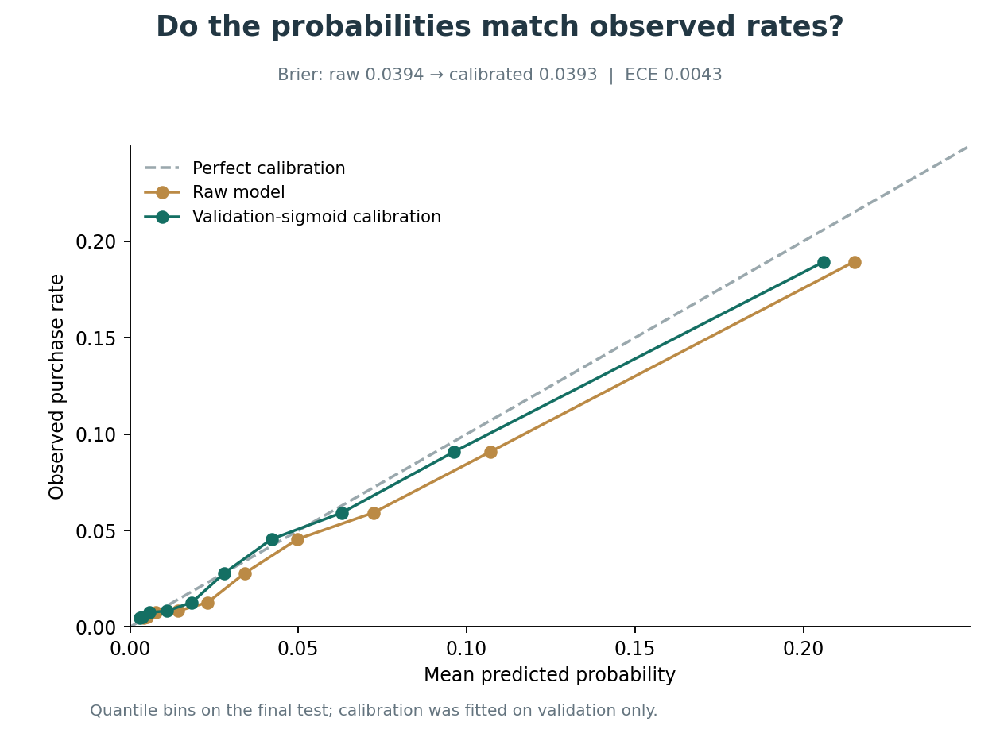

# Time-aware purchase propensity — actual H&M results

Landmark prediction estimates a customer's probability of returning within 7, 14 or 28 days. It does not estimate exact event times or causal recommendation effects.

## Selected models

| Horizon | Validation-selected model | Test customers | Prevalence | ROC-AUC | PR-AUC (AP) | Brier | Calibration ECE |
|---|---|---:|---:|---:|---:|---:|---:|
| 7d | random_forest | 49,421 | 4.52% | 0.8135 | 0.2089 | 0.0393 | 0.0043 |
| 14d | random_forest | 49,238 | 8.41% | 0.8190 | 0.3371 | 0.0659 | 0.0133 |
| 28d | logistic_raw | 48,806 | 15.57% | 0.8223 | 0.4915 | 0.1033 | 0.0065 |

7-day top-decile precision is 18.94%, recall 41.94%, lift 4.19× the eligible-population rate (4.52%).

## Design

Customers are eligible only after a purchase has been recorded before each cutoff; long-inactive users remain in the denominator. Without enrollment dates, using the final metadata roster to include future first-time customers would rely on retrospectively known membership.
All predictors use purchases strictly before each cutoff. Timing gaps use distinct shopping days; multiple basket items are not zero-day interpurchase gaps. Missing interval statistics have explicit flags. Product-type labels are static metadata; no post-cutoff customer fields are used.
Only fully matured future windows are labeled. The 7-day cutoffs match the ranker. The longer tasks shift earlier because the dataset ends on September 22, 2020. See cohorts.csv for exact dates, prevalence and excluded first-time purchasers.
All training negatives are retained. Model selection prioritizes average precision rather than accuracy. Logistic raw/log transforms are compared; C and boosting depth grids are small. Validation also fits sigmoid calibration. Base models remain trained on training weeks only so the calibrator's scoring distribution stays consistent; final test labels do not tune either component.
Calibration ECE uses up to 10 quantile bins and is a descriptive metric. Calibration is not guaranteed outside these periods. Overlapping customers across landmark dates are expected; there is no random row split. Rolling folds use fixed defaults independent of later tuning.

## Connection to recommendations

The primary test includes 2,232 returning buyers with saved top-12 lists; 220 additional first-time buyers are shown as an unmodeled history group. The original recommendation scores and article ordering stay fixed.
High/medium/low segments are capacity ranks of all eligible customers before inspecting outcomes: top 20%, next 30%, remaining 50%. Recommendation MAP/Recall/NDCG by segment condition on customers who actually buy; they are not classification metrics or overall population hit rates.
Prioritization tables use all eligible customers as the budget denominator and report captured purchasers and observed exact-match customers. Nonbuyers have no observed future match whatever products would be shown. Their ranking lists were not generated for this capacity analysis; these diagnostics do not measure engagement, catalog exposure or treatment effects.
New-history buyers have no learned propensity estimate in the historical-return task. A labeled prior-only placeholder is recorded privately, and this group is not assigned to the learned high/medium/low cohorts.

## Three measured résumé-ready results

1. 7-day propensity: ROC-AUC 0.8135, PR-AUC/AP 0.2089 on 49,421 known customers.
2. Top propensity decile: 4.19× purchase-rate lift, 18.94% precision, 41.94% of returning purchasers captured.
3. The unchanged recommender's held-out MAP@12 is 0.02607, 17.3% above the recent-purchase baseline on its original 2,452-purchaser cohort. This differs from the propensity population denominator.

## Reproduce

Run `make propensity` after preparing the existing sample and restoring/reproducing the frozen recommendation run. All feature tables, probabilities, IDs and serialized models remain ignored locally; public outputs are aggregate diagnostics plus anonymous examples.

