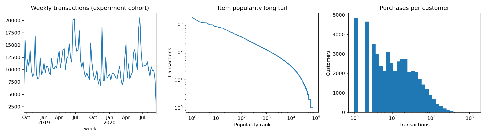

# H&M Recommendation & Learning-to-Rank — Experiment Report

Actual H&M transactions; 50,000 hash-sampled customers; 1,156,381 transactions across the complete observed date range.

Train label weeks: 2020-08-26, 2020-09-02; validation: 2020-09-09; test: 2020-09-16 (each 7 days).

History lookback: 120 days; model selection uses validation MAP@12 only. Selected policy: **xgboost_classifier**. Selected ML ranker: **xgboost_classifier**.

Test cohort: 2,452 customers with at least one next-week purchase, including zero-history customers. Every model uses the same users and ground truth. Missing recommendations score zero.

## Final test comparison

| Model | MAP@12 | Recall@12 | NDCG@12 |
|---|---:|---:|---:|
| xgboost_classifier | 0.02607 | 0.05530 | 0.03862 |
| random_forest | 0.02507 | 0.05287 | 0.03707 |
| lambdamart | 0.02495 | 0.05159 | 0.03676 |
| lightgbm_classifier | 0.02469 | 0.05381 | 0.03710 |
| logistic | 0.02462 | 0.05252 | 0.03615 |
| xgb_ndcg | 0.02447 | 0.05288 | 0.03641 |
| xgb_pairwise | 0.02432 | 0.05223 | 0.03623 |
| recent | 0.02224 | 0.04544 | 0.03239 |
| als | 0.01203 | 0.02832 | 0.01917 |
| cooccurrence | 0.00741 | 0.01820 | 0.01229 |
| segment | 0.00732 | 0.02203 | 0.01305 |
| content | 0.00710 | 0.01316 | 0.00999 |
| popularity | 0.00505 | 0.02132 | 0.01105 |

## Candidate recall

| Source | Candidate recall | Average pool size |
|---|---:|---:|
| popularity | 0.0534 | 40.0 |
| segment | 0.0477 | 40.0 |
| recent | 0.0381 | 9.8 |
| cooccurrence | 0.0248 | 30.5 |
| als | 0.0471 | 30.7 |
| content | 0.0151 | 30.7 |
| union | 0.1250 | 146.6 |

## Interpretation and limits

- This is a sampled-user development experiment, not a full-dataset leaderboard result. Popularity, co-occurrence, and ALS are fitted on the selected users; a larger cohort may change their quality.
- Zero labels mean no observed purchase, not a logged negative impression. Sampled classifier probabilities are relevance scores, not calibrated conversion probabilities.
- Static age and product descriptions come from the supplied metadata snapshot. No point-in-time membership or demographic snapshots are available; dynamic customer fields are excluded.
- Candidate eligibility is a prior-purchase lookback heuristic; the data has no live inventory feed. Future-unseen items remain in the ground-truth denominator but cannot be retrieved. 'First seen' is not a verified launch date.
- Repeated purchases remain eligible. A discovery-only policy would require a separate experiment.
- Candidate ablations freeze ranker and retained features. Feature ablations retrain on the same sampled training rows; retrieval remains fixed.
- Test ablations and segment findings are descriptive diagnostics after settings are frozen; they do not select the reported policy.
- LambdaMART uses metric-weighted pairwise gradients; XGBRanker is an interface, not an independent model family. The experiment separates XGBoost pairwise, XGBoost NDCG LambdaMART, and LightGBM LambdaMART.
- Offline purchase ranking cannot establish CTR, conversion, revenue lift, or a causal effect. The A/B plan is proposed only.

Runtime: 2.4 minutes. See `run_manifest.json` for exact package versions.

Generated analysis: `tuning.csv`, `segments.csv`, `catalog_diagnostics.csv`, `ablations.csv`, `selected_vs_popularity_bootstrap.json`, and `importance_*.csv`.

